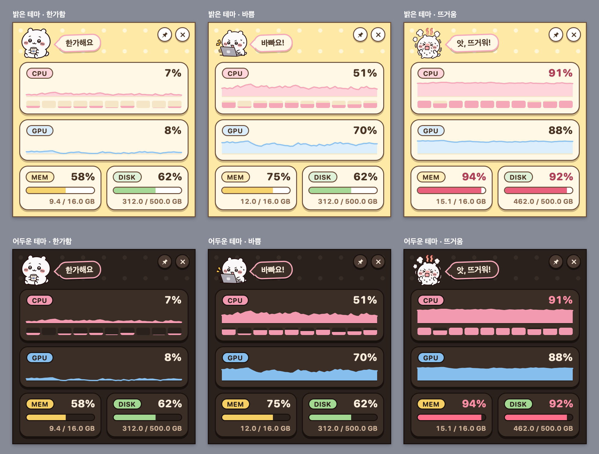
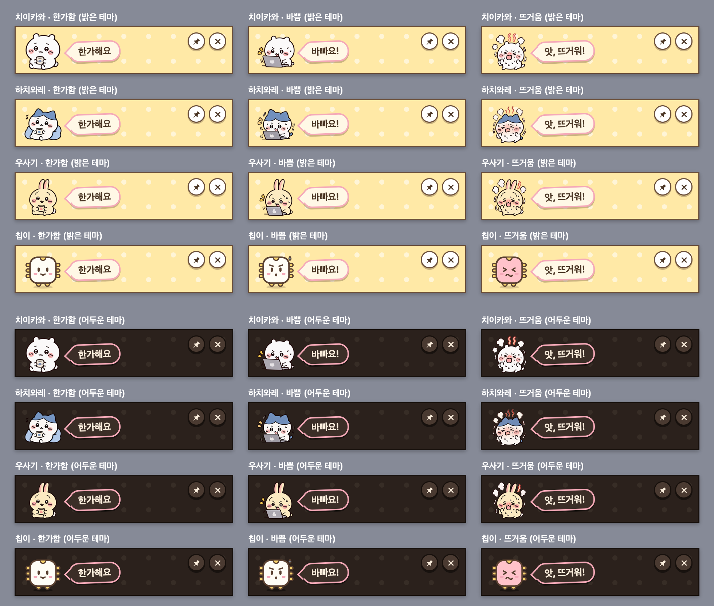

# 먼작귀모니터링

> 원작·권리자와 관계없는 **비공식 팬 프로그램**입니다. 포함된 캐릭터 그림은 팬이 만든 2차 창작물입니다.

Mac 메뉴 막대 / Windows 트레이에 상주하면서 CPU, GPU, 메모리, 디스크 상태를 1초마다 보여주는 작은 위젯입니다.

```
┌────────────────────────────────┐
│ [마스코트] (한가해요)    📌  ✕ │
│ ╭────────────────────────────╮ │
│ │ (CPU)                  37% │ │
│ │ ▂▃▅▃▂▄▆▅▃▂▂▃▄▃▂▃▅▄▃▂▂▃▄▅▃▂ │ │
│ │ ▮▮▯▮▯▮▮▯▮▯  (코어별)        │ │
│ ╰────────────────────────────╯ │
│ ╭────────────────────────────╮ │
│ │ (GPU)                  12% │ │
│ │ ▁▁▂▁▃▂▁▁▂▁▁▂▁▁▂▃▂▁▁▂▁▁▁▂▁▁ │ │
│ ╰────────────────────────────╯ │
│ ╭────────────╮  ╭────────────╮ │
│ │ (MEM)  58% │  │ (DISK) 62% │ │
│ │ ▰▰▰▰▰▱▱▱▱  │  │ ▰▰▰▰▰▰▱▱▱  │ │
│ │ 9.2/16.0GB │  │ 312/500 GB │ │
│ ╰────────────╯  ╰────────────╯ │
└────────────────────────────────┘
```



(위 그림은 앱 창을 찍은 것이 아니라, 앱에 들어가는 `ui/` 파일을 가짜 측정값(`ui/demo.js`)으로 WebKit에 그려서 찍은 것입니다.)

위쪽의 **마스코트**는 컴퓨터 상태에 따라 그림과 말이 바뀝니다. 마스코트는 트레이 메뉴의 `마스코트`에서 고릅니다.

| 마스코트 | |
|----------|---|
| 치이카와 (처음 기본값) · 하치와레 · 우사기 | 상태마다 그림 한 장(한가함·바쁨·뜨거움). 팬이 만든 2차 창작물 (`ui/mascot/`) |
| 칩이 | 이 앱에서 새로 그린 반도체 칩 모양 캐릭터. 그림 파일을 읽지 못하면 칩이가 대신 나옵니다 |



| 상태 | 조건 | 그림 마스코트 | 칩이 | 말 |
|------|------|---------------|------|----|
| 한가함 | 아래 둘 다 아님 | 차를 마시는 그림, 천천히 숨쉼 | 천천히 숨쉬고 가끔 눈을 깜빡임 | "한가해요" |
| 바쁨 | 최근 5초 CPU 평균 45% 이상, 또는 GPU 60% 이상 | 노트북을 두드리는 그림, 까딱거림 | 까딱거리며 땀방울 | "바빠요!" |
| 뜨거움 | 최근 5초 CPU 평균 85% 이상, 또는 메모리 90% 이상 | 김이 나는 그림, 가끔 떨림 | 분홍색 몸에 김이 나고 흔들림 | "앗, 뜨거워!" |

한 번 바뀐 상태는 적어도 5초 동안 유지됩니다. 측정값이 경계 근처에서 오르내려도 그림과 말이 매초 바뀌지 않습니다.
상태가 바뀌거나 마스코트를 바꾸면 톡 튀어 오르며 바뀝니다.

## 기능

- **CPU**: 전체 사용률, 최근 60초 그래프, 코어별 막대 (코어가 33개 이상이면 같은 높이 안에서 두 줄 이상으로 나눠 그려서 창 크기는 그대로)
- **GPU**: 사용률과 최근 60초 그래프. 읽을 수 없는 기기에서는 `N/A`
- **MEM / DISK**: 사용률(%), 막대, 사용량
- 어느 항목이든 90% 이상이면 숫자가 경고색 (MEM / DISK는 막대도)
- 밝은 테마 / 어두운 테마는 시스템 설정을 따름
- 시스템에서 "동작 줄이기"를 켜면 마스코트가 움직이지 않고, 창이 보이지 않는 동안에도 움직임을 멈춤
- 메뉴 막대(Mac)에 `CPU 37%  MEM 58%` 요약 표시, Windows에서는 트레이 아이콘 툴팁
- 트레이 아이콘 왼쪽 클릭으로 위젯 열기/닫기, 오른쪽 클릭 메뉴 `열기` / `마스코트` / `종료`
- **마스코트 고르기**: 메뉴의 `마스코트`에서 치이카와·하치와레·우사기·칩이 중 하나를 고름(지금 고른 것에 ✓). 위젯이 열려 있으면 바로 바뀌고,
  닫혀 있으면 다음에 열 때 반영됨. 고른 것은 앱을 다시 실행해도 유지되고, 고른 적이 없으면 치이카와
- 위쪽 띠(마스코트와 말풍선이 있는 곳)를 끌어 창 이동
- 📌 버튼으로 항상 위에 고정, ✕ 버튼으로 닫기 (앱은 트레이에 남음, 아래 "메모리" 참고)
- 이미 실행 중일 때 다시 실행하면 하나 더 뜨지 않고 위젯이 열리면서 "이미 실행 중" 알림이 뜹니다
- 관리자 권한이 필요 없습니다

첫 버전에 없는 것: 온도·팬 속도, 경고 알림, 기록 저장. 프로그램별 CPU·GPU·메모리 목록은 앱이 수집해 보내는 데까지 들어가 있고,
위젯 화면에는 아직 없습니다(아래 "프로그램별 사용량").

## 내려받아 쓰기

Rust나 Node를 설치할 필요가 없습니다. [Releases](../../releases/latest)에서 파일 하나만 받으면 됩니다.

| OS | 받을 파일 |
|----|-----------|
| macOS (Apple Silicon, Intel 공용) | `_<버전>_universal.dmg` |
| Windows 10 / 11 | `_<버전>_x64-setup.exe` (또는 `_<버전>_x64_ko-KR.msi`) |

GitHub이 파일 이름에서 한글을 빼서 이름이 밑줄로 시작합니다. 설치되는 앱 이름은 먼작귀모니터링입니다.

서명(유료 인증서)이 없는 앱이라 처음 열 때 한 번 경고가 뜹니다.

- **macOS**: `.dmg`를 열어 앱을 응용 프로그램 폴더로 옮기고 실행합니다. "열 수 없습니다"가 뜨면
  시스템 설정 → 개인정보 보호 및 보안 → 아래쪽의 **그래도 열기**를 누릅니다. 그 뒤로는 그냥 열립니다.
  그래도 열리지 않으면 터미널에서 `xattr -dr com.apple.quarantine /Applications/먼작귀모니터링.app` 을 한 번 실행합니다.
- **Windows**: 설치 파일을 실행했을 때 "Windows의 PC 보호"가 뜨면 **추가 정보 → 실행**을 누릅니다.

> Windows용 파일은 GitHub의 Windows 기기에서 자동으로 빌드된 것입니다. 빌드와 테스트는 통과했지만, 실제 Windows PC에서 실행해 확인한 적은 없습니다.

새 버전은 `v0.2.0` 같은 태그를 올리면 `.github/workflows/release.yml`이 자동으로 빌드해 Releases에 올립니다.

## 개발 실행

필요한 것: [Rust](https://rustup.rs), Node.js 20 이상.

```sh
npm install
npm run tauri dev
```

## 테스트

```sh
cargo test --manifest-path src-tauri/Cargo.toml
npm test
```

## 배포 빌드

```sh
npm run tauri build
```

- macOS: `src-tauri/target/release/bundle/macos/먼작귀모니터링.app` 과 `.dmg`
- Windows: `src-tauri\target\release\bundle\` 아래 `.msi` / `.exe` 설치 파일

### Windows에서 빌드하기

Windows 빌드는 Windows PC에서 해야 합니다.

1. [Rust](https://rustup.rs) 설치 (설치 중 안내되는 **MSVC C++ Build Tools** 포함)
2. Node.js 설치
3. WebView2 런타임 (Windows 10 최신 버전과 Windows 11에는 기본 포함)
4. 저장소 폴더에서 `npm install` 후 `npm run tauri build`

> **Windows 검증 상태**: Windows용 GPU 코드는 Windows 대상으로 타입 검사만 통과했고,
> 실제 Windows 기기에서 실행해 본 적은 없습니다. 처음 빌드하면 GPU 값이 작업 관리자의
> GPU 사용률과 비슷한지 확인해 주세요.

## 메모리

위젯 화면은 WebKit 웹뷰가 그리고, 웹뷰는 앱 본체 밖에 WebKit 보조 프로세스
(WebContent / GPU / Networking)를 따로 띄웁니다. 메모리 대부분은 이 보조 프로세스,
특히 GPU 프로세스가 씁니다. 그래서 위젯을 닫으면(✕, 트레이 왼쪽 클릭) 창과 웹뷰를
숨기는 대신 **해제**하고, 다시 열 때 새로 만듭니다. 웹뷰가 없어지면 보조 프로세스도
종료됩니다. 앱 본체는 트레이에 남아 메뉴 막대 요약을 계속 1초마다 갱신합니다.
창이 없는 동안에는 메뉴 막대에 필요한 CPU 전체 사용률과 메모리만 읽고, 코어별 값·GPU·디스크
수집과 화면 전송은 하지 않습니다.

📌 고정 상태와 고른 마스코트는 웹뷰가 아니라 앱이 기억합니다(앱 설정 폴더의 `pinned`, `mascot` 파일).
마스코트 그림은 웹뷰가 열릴 때만 읽으므로, 위젯이 닫힌 동안의 메모리는 그대로입니다.
웹뷰는 저장소를 남기지 않는 모드로 열어서, 위젯을 닫으면 Networking 프로세스도 함께 종료됩니다.

### 재는 법 (macOS)

```sh
scripts/measure-memory.sh --app "src-tauri/target/release/bundle/macos/먼작귀모니터링.app"
scripts/measure-memory.sh --pid <pid> --settle 60   # 60초 기다린 뒤 측정
```

- 앱 본체와 그 앱이 띄운 WebKit 보조 프로세스의 `footprint`(활동 상태 보기의 "메모리" 값)를
  프로세스별로 보여 주고 합계를 냅니다. RSS도 참고로 같이 보여 줍니다.
- 보조 프로세스는 macOS가 기록하는 "책임 프로세스"로 이 앱 것인지 가립니다. 근거는 스크립트 주석에 있습니다.
- 지금 위젯이 열려 있는지 닫혀 있는지도 함께 출력합니다. 열린 상태와 닫힌 상태에서 한 번씩 재면 됩니다.
  닫은 직후에는 GPU 프로세스가 1분 안쪽으로 정리되므로 `--settle 60`을 권합니다.
- 클릭 없이 상태를 바꾸려면 앱을 `SYSTEM_MONITOR_DIAG=1`로 띄운 뒤
  `".../Contents/MacOS/system-monitor" --hide` / `--show` / `--toggle`을 실행합니다.
  `--mascot=<이름>`(`chiikawa`, `hachiware`, `usagi`, `chip`)은 트레이 메뉴에서 마스코트를 고른 것과 같습니다.
  `--detail=<종류>`(`cpu`, `gpu`, `mem`, `off`)는 위젯이 프로그램별 목록을 연 것과 같고, 읽은 목록과 읽는 데 든 시간이 찍힙니다
  (위젯이 열려 있을 때만 읽습니다. 아래 "프로그램별 사용량").
  이 진단 모드에서는 창 생성·해제와 메뉴 막대 갱신, 위젯이 지금 보여 주는 것(마스코트·상태·그림 파일·움직임 이름)이 stderr에 찍힙니다. 진단 모드가 아니면 이 인자들은 무시되고, 다시 실행하면 위젯이 열리고 "이미 실행 중" 알림이 뜹니다.

### 변경 전후 (Apple Silicon Mac, macOS 26, 릴리스 빌드)

footprint 합계(앱 본체 + WebKit 보조 프로세스), 여러 번 잰 범위입니다.

| 상태 | 변경 전 | 변경 후 |
|------|---------|---------|
| 위젯 열림 | 173–174 MiB (본체 33 + GPU 119 + WebContent 16 + Networking 5) | 172–176 MiB (본체 33 + GPU 121 + WebContent 18 + Networking 5) |
| 위젯 닫힘 | 178–181 MiB (보조 프로세스 3개가 그대로 살아 있음) | **30–31 MiB** (본체만, 보조 프로세스 0개) — 약 83% 감소 |

- 닫힘 상태는 닫은 뒤 60초 이상 지나서 잰 값입니다. 닫은 직후 30초쯤은 GPU 프로세스가 정리 중이라 약 44 MiB입니다.
- 위젯이 열려 있을 때의 메모리는 웹뷰가 그대로라 거의 같습니다.
- 닫힘 상태에서 수집을 줄인 것은 메모리 차이가 측정 오차(약 1 MiB) 안이었고, 대신 본체 CPU 시간이
  2분에 2.3–2.5초에서 1.7–1.8초로 줄었습니다.
- Windows에서는 재지 않았습니다. 같은 코드로 창과 WebView2가 해제되지만, 보조 프로세스가 실제로 종료되는지는 확인하지 못했습니다.

### 새 화면(칩이) 적용 후 메모리

화면만 다른 두 릴리스 빌드(Rust 코드는 같음)를 한 번에 하나씩 띄워 번갈아 잰 값입니다. 위젯이 열린 상태,
실행 30초 뒤와 약 2분 뒤의 footprint 합계입니다.

| | 옛 화면 (300×240) | 새 화면 (300×320, 칩이) |
|---|---|---|
| 합계 | 174.6–176.8 MiB | 177.6–181.9 MiB (+2~3%) |
| 본체 | 29–32 MiB | 30–33 MiB |
| WebKit GPU | 121 MiB | 122–123 MiB |
| WebKit WebContent | 18–20 MiB | 19–24 MiB |
| WebKit Networking | 5 MiB | 5 MiB |

- GPU 프로세스의 약 105 MiB는 화면 내용과 상관없이 "1초마다 다시 그리는 것" 자체에 붙습니다. 같은 화면을 한 번만
  그리고 멈춰 두면 GPU 프로세스는 11–17 MiB입니다(WKWebView 하나만 띄운 시험용 호스트에서 잰 값).
- 페이지 전체에 반복 gradient로 점무늬를 깔면 WebContent가 약 7 MiB 늘어서, 점은 위쪽 띠에만 SVG로 그립니다.
- 위젯을 닫았을 때의 동작과 수치(본체만 약 30 MiB)는 그대로입니다.

### 그림 마스코트 적용 후 메모리

같은 릴리스 빌드에서 마스코트만 바꿔 가며(한 번에 하나씩 새로 띄움) 잰 값입니다. 위젯이 화면에 보이는 상태,
실행 30~45초 뒤와 약 2분 뒤의 footprint 합계입니다.

| | 칩이 | 그림 마스코트 (치이카와) |
|---|---|---|
| 합계 | 177.6–182.3 MiB (5번) | 173.4–185.1 MiB (7번) |
| 본체 | 30–35 MiB | 30–35 MiB |
| WebKit GPU | 122–123 MiB | 121–123 MiB |
| WebKit WebContent | 20–22 MiB | 19–26 MiB |
| WebKit Networking | 5 MiB | 4–5 MiB |

- 평균은 칩이 179.8 MiB, 그림 179.0 MiB로 차이가 측정마다의 흔들림(±3%)보다 작습니다. 그림은 144px 세 장이고
  펼쳐도 장당 83 KB입니다.
- 위젯을 닫았을 때는 그대로 본체만 30.0 MiB입니다(닫고 60초 뒤). 그림은 웹뷰가 열릴 때만 읽습니다.
- 번들 크기는 그림과 새 아이콘으로 `.app` 5.3 → 5.7 MiB, `.dmg` 2.7 → 3.5 MiB가 됐습니다.

### CPU

```sh
scripts/measure-cpu.sh --app "src-tauri/target/release/bundle/macos/먼작귀모니터링.app" --seconds 75
```

앱 본체와 WebKit 보조 프로세스의 누적 CPU 시간이 그 시간 동안 얼마나 늘었는지를 경과 시간으로 나눈 평균입니다
(100% = 코어 하나를 계속 씀). 위젯이 열린 상태에서 75초씩 잰 값입니다.

| 화면 | 평균 CPU | 본체 | WebContent | GPU |
|------|----------|------|------------|-----|
| 새 화면 (칩이가 움직임) | 5.0–5.5% | 3.2–3.4% | 1.0–1.3% | 0.6–1.0% |
| 새 화면, 칩이의 상시 움직임 끔 | 4.0% | 2.6–2.8% | 0.7–0.8% | 0.6% |
| 옛 화면 | 4.4–4.6% | 2.9–3.0% | 0.8–0.9% | 0.6–0.7% |
| 위젯 닫힘 (본체만) | 1.5% | 1.5% | 없음 | 없음 |

- 칩이의 상시 움직임(숨쉬기, 깜빡임)이 약 1%p를 씁니다. `ui/main.js`의 `IDLE_MOTION`을 `false`로 바꾸면 어느 마스코트든 상시 움직임이 꺼집니다
  (표정·그림은 계속 바뀜). 측정값이 오는 간격은 `src-tauri/src/lib.rs`의 `SAMPLE_INTERVAL`입니다.
- 움직임을 뺀 새 화면은 옛 화면보다 조금 가볍습니다(바뀌지 않은 글자는 다시 쓰지 않음).
- 그림 마스코트(치이카와, 한가함)는 60~75초씩 네 번 재서 4.6–5.0%(한 번은 6.8%), 같은 날 칩이는 3.4–5.0%였습니다.
  움직임 규칙이 같아서 차이는 측정마다의 흔들림 안입니다.
- 숨쉬기·까딱임을 CSS 애니메이션 대신 타이머로 장면을 바꾸는 시험 빌드는 세 번 재서 3.2–4.4%가 나왔습니다. 다만 재는
  동안 위젯이 다른 Space에 가려진 회차가 섞여 있어 더 싸다고 확정하지 못했고, 지금은 CSS 애니메이션을 씁니다.
- 잴 때 기기는 다른 작업으로 CPU 16–30%, 메모리 84–89%를 쓰고 있었습니다. 한가한 기기에서는 더 낮을 수 있습니다.
- Windows에서는 재지 않았습니다.

## 프로그램별 사용량

CPU·GPU·메모리를 어느 프로그램이 얼마나 쓰는지 보여 주는 목록입니다. 앱은 위젯이 **목록을 열어 달라고 할 때만**,
**그 한 종류만** 프로세스를 읽습니다. 목록이 닫혀 있거나 위젯이 닫혀 있으면 아무것도 읽지 않습니다.

### 화면에서 쓰는 법 (웹뷰 ↔ 앱)

- 열기·바꾸기·닫기: `invoke("set_detail", { kind })`, `kind`는 `"cpu"`, `"gpu"`, `"mem"`, `"off"` 중 하나.
  다른 값이면 오류를 돌려줍니다. 위젯 창이 해제되면(✕, 트레이) 앱이 알아서 `"off"`로 돌리고, 새로 열린 위젯은 목록이 닫힌 상태로 시작합니다.
- 결과: 이벤트 `detail`. 주기는 GPU 1초, CPU·메모리 2초(아래 "부하").
  - CPU·GPU는 비율이라 두 번 읽어야 해서, 연 뒤 첫 이벤트는 약 1초 뒤에 옵니다. 메모리는 바로 옵니다. 그 사이에는 "재는 중"으로 보여 주면 됩니다.
  - 목록을 바꾼 직후에는 앞 종류의 이벤트가 하나 늦게 올 수 있으니 `kind`가 지금 연 것과 다르면 버립니다.

```jsonc
{
  "kind": "cpu",            // "cpu" | "gpu" | "mem"
  "available": true,        // false: 이 기기에서는 이 목록을 읽을 수 없음 (아래). 그때 programs는 [], 숫자는 0
  "programs": [             // 큰 순서, 최대 8개, 값이 0보다 큰 것만 (같은 값이면 이름 순)
    { "name": "Google Chrome Helper (Renderer)", "count": 12, "value": 34.5, "rss": false }
  ],
  "others": { "programs": 431, "count": 690, "value": 60.4 },  // 8개 밖의 프로그램 수, 프로세스 수, 값의 합
  "total": 323.6,           // 모든 프로세스 값의 합 (programs + others)
  "processes": 731,         // 센 프로세스 수
  "unreadable": 4           // 아무것도 읽을 수 없어 빼놓은 프로세스 수 (processes에 들어 있지 않음)
}
```

| `kind` | `value`의 단위 | 뜻 |
|--------|----------------|----|
| `cpu` | 코어 하나 = 100 (%) | 활동 상태 보기의 "% CPU"와 같은 기준. 230이면 코어 2.3개만큼 → "230% (2.3코어)". 100을 넘을 수 있음 |
| `gpu` | GPU 전체 = 100 (%) | 그 프로그램이 GPU를 쓴 시간 ÷ 지난 시간. 프로그램마다 0–100 |
| `mem` | 바이트 | macOS는 활동 상태 보기의 "메모리"(물리 footprint). `rss: true`면 그 프로그램의 일부 또는 전부를 RSS로 셈(아래) |

- **묶기**: 실행 파일 이름이 같은 프로세스는 하나로 합치고 `count`에 개수를 줍니다(예: "Google Chrome Helper (Renderer)" 12개).
  이름은 실행 파일 이름 그대로입니다(macOS는 경로의 마지막 부분, Windows는 `chrome.exe`처럼 확장자 포함).
- **GPU를 못 읽을 때**: `{"kind":"gpu","available":false,"programs":[],...}`가 옵니다. Intel Mac(아래), GPU 성능 카운터가 없는 Windows가 그렇습니다.
  전체 GPU 사용률(`snapshot.gpu`)과는 별개라, 전체 값은 보이는데 프로그램별은 없을 수 있습니다.
- 모양은 `src-tauri/src/procs.rs`의 `DetailList`, 명령은 `src-tauri/src/lib.rs`의 `set_detail`에도 적혀 있습니다.

### 숫자의 출처와 한계

**macOS**

- CPU: `/bin/ps -axo pid=,time=,rss=,comm=`의 누적 CPU 시간이 두 번 읽는 사이에 늘어난 만큼 ÷ 지난 시간입니다. `ps`는 시스템에 원래 있는
  set-uid 도구라, 이 앱이 관리자 권한 없이도 WindowServer·mds 같은 root 소유 프로세스까지 읽습니다(앱이 직접 읽으면 약 200개가 0으로 나옵니다).
  `ps`의 `%cpu` 열은 감쇠 평균이라 쓰지 않습니다. 같은 시각 `top`과 상위 다섯 개의 순서와 크기가 비슷했습니다(아래 "확인한 것").
- 메모리: 이 사용자의 프로세스는 `proc_pid_rusage`의 `ri_phys_footprint`(활동 상태 보기의 "메모리"와 같은 값)를 씁니다. 다른 사용자(root 등)의
  프로세스는 이 값을 관리자 권한 없이 읽을 수 없어 `ps`의 RSS로 대신하고 `rss: true`로 표시합니다. RSS는 footprint와 다릅니다. 특히
  WindowServer처럼 GPU 메모리를 많이 쓰는 프로세스는 RSS가 훨씬 작게 나옵니다(예: top의 메모리 636 MB, RSS 약 55 MB).
- 빠지는 것: `kernel_task`(pid 0)는 `ps`에 나오지 않아 CPU·메모리 목록에 없습니다. `top`으로는 읽히지만 한 번에 CPU 약 0.65초가 들어
  쓰지 않습니다. 보안 에이전트처럼 `ps`로도 아무것도 안 읽히는 보호된 프로세스는 `unreadable`로 셉니다(이 기기에서 4개).
- GPU: Apple Silicon에서는 프로세스가 GPU를 열 때마다 IORegistry의 가속기(`AGXAccelerator…`) 아래에 사용자 클라이언트(`AGXDeviceUserClient`)가
  생기고, 여기에 `IOUserClientCreator`(`"pid 176, WindowServer"`)와 명령 큐별 `AppUsage.accumulatedGPUTime`(지금까지 쓴 GPU 시간, 나노초)이
  있습니다. 관리자 권한 없이 읽히는 공개 IOKit 값입니다(`ioreg -r -c AGXDeviceUserClient -l -w0`로도 보임). 클라이언트별로 1초 사이에 늘어난 시간을 더해
  지난 시간으로 나눕니다. 나노초 단위는 같은 항목의 `lastSubmittedTime`이 부팅 후 경과 시간과 맞는 것으로 확인했습니다.
  - 정확도: GPU 일을 정해진 비율로 시키는 시험 프로그램으로 대조했습니다(아래). 그 프로그램은 1위로 올라오고, 목록 합계는 전체 GPU 사용률과
    부하가 높을 때 1–3%p, 중간일 때 10–15%p 낮게 나옵니다. 전체 사용률(`Device Utilization %`)은 GPU가 바쁜 시간 전부를 세고 목록은 프로그램이 낸
    일의 실행 시간만 세서 생기는 차이로 보입니다. 1초 사이에 생겼다 닫힌 클라이언트의 시간은 셀 수 없어 빠집니다.
  - Intel Mac 등 클라이언트에 `AppUsage`가 없는 기기에서는 `available: false`입니다(Intel Mac에서는 확인하지 못했습니다).
- 이름: CPU·메모리는 `ps`의 실행 파일 경로, GPU는 `proc_pidpath`로 같은 실행 파일 이름을 씁니다. 그래서 세 목록의 이름이 같습니다.

**Windows** (실제 Windows 기기에서 실행해 보지 않았습니다. 빌드는 Windows 대상 타입 검사만, 계산은 순수 함수 테스트로 확인)

- CPU·메모리: `sysinfo`의 프로세스별 CPU(코어 하나 = 100)와 working set. 다른 사용자의 보호된 프로세스처럼 메모리가 0으로 읽히는 것은 `unreadable`로 셉니다.
- GPU: 전체 GPU에 쓰는 `\GPU Engine(*)\Utilization Percentage` 카운터를 같은 한 번의 읽기에서 인스턴스 이름의 `pid_N`으로 나눕니다.
  프로세스마다 어댑터·엔진 종류(3D, VideoDecode …)별로 더하고 그중 가장 바쁜 값을 씁니다(작업 관리자의 프로세스별 GPU 열과 같은 규칙,
  전체 GPU 값과 같은 어댑터·엔진 규칙). 카운터가 없으면 `available: false`.

### 부하

후보 릴리스 빌드(Apple Silicon Mac, macOS 26), 위젯이 열린 상태입니다. `ps` 실행분은 `scripts/measure-cpu.sh`에 잡히지 않아(앱이 띄웠다 바로 끝나는
자식 프로세스) 진단 로그의 `child cpu`를 더해 따로 적었습니다.

| 목록 | 한 번 읽는 데 | 주기 | 늘어나는 CPU |
|------|---------------|------|--------------|
| 닫힘(`off`) | 읽지 않음 | | 0 |
| CPU·메모리 | 40–55 ms, 그중 `ps`가 CPU 33–45 ms | 2초 | `ps` 약 1.9% (코어 하나 기준), 앱 본체는 측정 흔들림 안 |
| GPU | 1–3 ms (IORegistry만 읽음) | 1초 | 측정 흔들림 안 |

- CPU·메모리를 1초마다 읽으면 `ps`만으로 약 3.9%가 되어, 위젯 전체(약 4–5%)에 맞먹으므로 2초로 정했습니다. 주기는 `lib.rs`의 `detail_every`입니다.
- 메모리는 목록을 열어도 그대로였습니다(합계 178–179 MiB). 목록을 읽는 부분은 목록이 열릴 때 만들고 닫힐 때 버립니다.

목록이 닫혀 있을 때(`off`)는 변경 전과 같습니다. 같은 날 변경 전(`main`) 빌드와 번갈아 잰 footprint 합계와 평균 CPU입니다.

| 상태 | 변경 전 (`main`) | 변경 후, 목록 닫힘 |
|------|------------------|--------------------|
| 위젯 열림, 메모리 | 178.3 MiB | 178.2, 180.4 MiB |
| 위젯 열림, CPU | (README 앞쪽 값 4.4–5.5%) | 3.05, 3.59% |
| 위젯 닫힘, 메모리 (닫고 60초 뒤) | 29.3, 31.9 MiB | 28.0, 30.9 MiB |
| 위젯 닫힘, CPU | 1.32, 1.33% | 1.13, 1.23% |

- 목록이 닫힌 동안과 위젯이 닫힌 동안의 진단 로그에는 목록을 읽은 줄이 하나도 없습니다. 목록을 연 채 위젯을 닫으면 목록도 꺼지고,
  위젯이 닫힌 동안 목록을 요청해도 다음 1초 안에 꺼져 읽지 않습니다.
- 변경 전 빌드의 "위젯 열림" CPU는 이번에 재지 못했습니다. 재는 도중 측정 스크립트가 닫기 전에 위젯 창이 닫혀(진단 로그에 `window destroyed`)
  값이 나오지 않았습니다(무엇이 닫았는지는 확인하지 않았습니다). 그래서 앞쪽 "CPU" 표의 값과 비교했습니다.

### 확인한 것 (macOS)

같은 순간에 진단 로그와 `top -l 3 -s 2`를 나란히 놓고 비교했습니다. Spotlight 색인 중이라 시스템 프로세스가 바쁜 때였습니다.

| CPU (코어 하나 = 100) | 목록 | top |
|-----------------------|------|-----|
| mds_stores | 84.8 | 68.1 |
| mds | 35.0 | 32.2 |
| Google Chrome Helper (Renderer) | 26.8 (35개 합) | 30.6 (1개) |
| mobileassetd | 25.9 | 28.1 |
| XProtectRemediatorMRTv3 | 22.0 | 23.0 |
| kernel_task | 없음 | 15.7 |

| 메모리 (MiB) | 목록 | top (같은 이름 합) |
|--------------|------|--------------------|
| idea | 3998 | 3998 |
| Figma Helper (Renderer) ×9 | 3649 | 3653 |
| cmux | 1642 | 1642 |
| Figma Helper ×3 | 1204 | 1203 |

GPU는 창 없이 Metal 계산만 정해진 비율로 시키는 작은 시험 프로그램(`gpuload`, 저장소 밖, 화면에 아무것도 그리지 않음)으로 확인했습니다.

| 시험 부하 | 시험 프로그램이 잰 자기 GPU 시간 | 목록의 그 프로그램 | 목록 합계 | 전체 GPU (`Device Utilization %`) |
|-----------|-------------------------------|--------------------|-----------|-----------------------------------|
| 없음 | | | 1.0–1.1% (cmux 0.8–0.9% 1위) | |
| 50% | 47% | 37–42% (1위) | 41–44% | 54–59% |
| 90% | 84% | 80–82% (1위) | 82–85% | 83–86% |

## 구조

| 경로 | 역할 |
|------|------|
| `src-tauri/src/snapshot.rs` | 한 번의 측정값(`Snapshot`)과 순수 계산 |
| `src-tauri/src/collector.rs` | CPU·메모리·디스크 수집 (`sysinfo`) |
| `src-tauri/src/gpu/macos.rs` | Mac GPU 사용률 (IOKit `IOAccelerator`)과 프로그램별 GPU 시간(가속기의 사용자 클라이언트) |
| `src-tauri/src/gpu/windows.rs` | Windows GPU 사용률과 프로그램별 GPU (성능 카운터 `GPU Engine`) |
| `src-tauri/src/tray.rs` | 트레이 아이콘, 메뉴(마스코트 고르기 포함), 요약 표시 |
| `src-tauri/src/mascot.rs` | 고를 수 있는 마스코트 목록, 저장된 선택 읽기(없으면 치이카와) |
| `src-tauri/src/widget.rs` | 위젯 창 열기·닫기(닫으면 해제), 위치·📌·마스코트 기억 |
| `src-tauri/src/lib.rs` | 앱 조립, 1초 주기 샘플러 스레드, 프로그램별 목록 켜고 끄기(`set_detail`) |
| `src-tauri/src/procs.rs` | 프로그램별 목록의 모양(`DetailList`)과 순수 계산 (같은 이름 묶기, 상위 8개, `ps` 출력 읽기, CPU 비율) |
| `src-tauri/src/procdata.rs` | 프로그램별 CPU·메모리 읽기(macOS `ps`·footprint, Windows `sysinfo`)와 GPU 목록의 이름 찾기 |
| `ui/` | 위젯 화면 (프레임워크 없는 HTML/CSS/JS). 마스코트는 `ui/mascot.js`가 그리고(칩이는 SVG, 나머지는 그림), 움직임은 `ui/mascot.css` |
| `ui/mascots.js` | 마스코트 이름, 기본값, 상태별 그림 파일 (순수 계산) |
| `ui/mascot/<이름>/` | 그림 마스코트의 상태별 그림(`idle.png`, `busy.png`, `hot.png`, 144px). 팬이 만든 2차 창작물 |
| `ui/format.js` | 표시용 순수 계산 (단위, 그래프 좌표, 코어 막대 배치, 상태 판정과 유지) |
| `ui/demo.js` | 브라우저에서 화면만 볼 때 쓰는 가짜 측정값 (앱에서는 쓰지 않음) |
| `src-tauri/icons/src/` | 앱 아이콘(`icon-large.png`)과 메뉴 막대·트레이 아이콘(`icon-small.png`)의 원본 그림 (팬이 만든 2차 창작물) |
| `scripts/build-icons.sh` | 원본 그림에서 아이콘 파일 만들기 (macOS) |
| `scripts/measure-memory.sh` | 실행 중인 앱의 메모리 측정 (macOS) |
| `scripts/measure-cpu.sh` | 실행 중인 앱의 평균 CPU 측정 (macOS) |
| `docs/design/reference-notes.md` | 화면 디자인의 출처와 수치 |

설계와 구현 계획은 `docs/superpowers/`에 있습니다.
