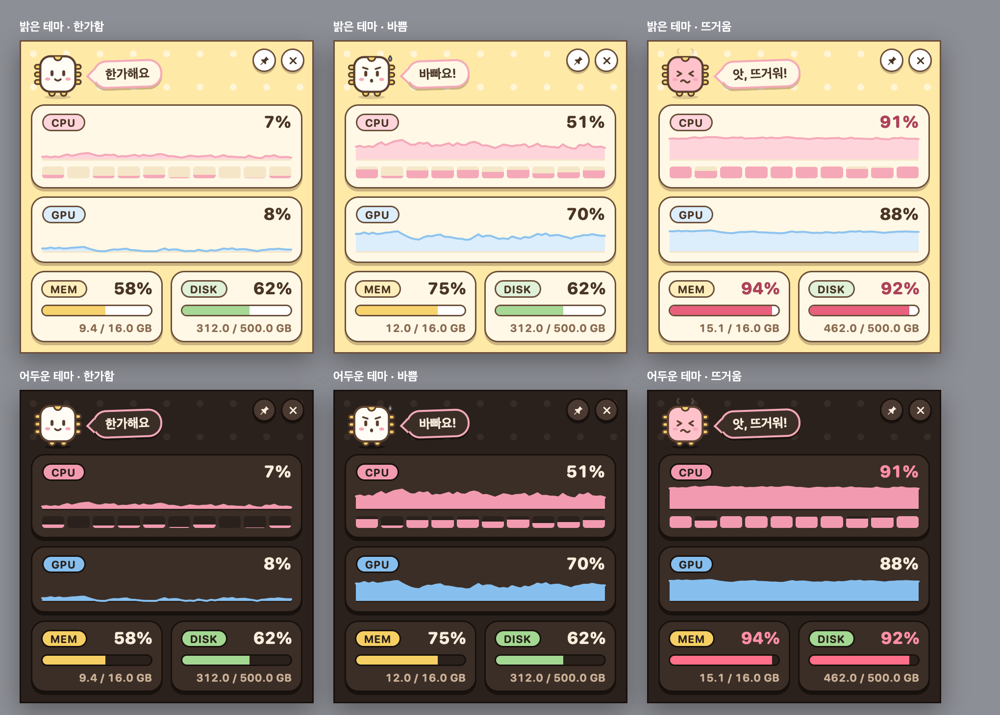

# System Monitor

Mac 메뉴 막대 / Windows 트레이에 상주하면서 CPU, GPU, 메모리, 디스크 상태를 1초마다 보여주는 작은 위젯입니다.

```
┌────────────────────────────────┐
│ [칩이] (한가해요)        📌  ✕ │
│ ╭────────────────────────────╮ │
│ │ (CPU)                  37% │ │
│ │ ▂▃▅▃▂▄▆▅▃▂▂▃▄▃▂▃▅▄▃▂▂▃▄▅▃▂ │ │
│ │ ▮▮▯▮▯▮▮▯▮▯  (코어별)        │ │
│ ╰────────────────────────────╯ │
│ ╭────────────────────────────╮ │
│ │ (GPU)                  12% │ │
│ │ ▁▁▂▁▃▂▁▁▂▁▁▂▁▁▂▃▂▁▁▂▁▁▁▂▁▁ │ │
│ ╰────────────────────────────╯ │
│ ╭────────────╮  ╭────────────╮ │
│ │ (MEM)  58% │  │ (DISK) 62% │ │
│ │ ▰▰▰▰▰▱▱▱▱  │  │ ▰▰▰▰▰▰▱▱▱  │ │
│ │ 9.2/16.0GB │  │ 312/500 GB │ │
│ ╰────────────╯  ╰────────────╯ │
└────────────────────────────────┘
```



(위 그림은 앱 창을 찍은 것이 아니라, 앱에 들어가는 `ui/` 파일을 가짜 측정값(`ui/demo.js`)으로 WebKit에 그려서 찍은 것입니다.)

위쪽의 **칩이**는 이 앱의 마스코트(반도체 칩 모양)로, 컴퓨터 상태에 따라 표정과 말이 바뀝니다.

| 상태 | 조건 | 칩이 |
|------|------|------|
| 한가함 | 아래 둘 다 아님 | 천천히 숨쉬고 가끔 눈을 깜빡임, "한가해요" |
| 바쁨 | 최근 5초 CPU 평균 45% 이상, 또는 GPU 60% 이상 | 까딱거리며 땀방울, "바빠요!" |
| 뜨거움 | 최근 5초 CPU 평균 85% 이상, 또는 메모리 90% 이상 | 분홍색 몸에 김이 나고 흔들림, "앗, 뜨거워!" |

## 기능

- **CPU**: 전체 사용률, 최근 60초 그래프, 코어별 막대
- **GPU**: 사용률과 최근 60초 그래프. 읽을 수 없는 기기에서는 `N/A`
- **MEM / DISK**: 사용률(%), 막대, 사용량
- 어느 항목이든 90% 이상이면 숫자가 경고색 (MEM / DISK는 막대도)
- 밝은 테마 / 어두운 테마는 시스템 설정을 따름
- 시스템에서 "동작 줄이기"를 켜면 칩이가 움직이지 않고, 창이 보이지 않는 동안에도 움직임을 멈춤
- 메뉴 막대(Mac)에 `CPU 37%  MEM 58%` 요약 표시, Windows에서는 트레이 아이콘 툴팁
- 트레이 아이콘 왼쪽 클릭으로 위젯 열기/닫기, 오른쪽 클릭 메뉴 `열기` / `종료`
- 위쪽 띠(칩이와 말풍선이 있는 곳)를 끌어 창 이동
- 📌 버튼으로 항상 위에 고정, ✕ 버튼으로 닫기 (앱은 트레이에 남음, 아래 "메모리" 참고)
- 이미 실행 중일 때 다시 실행하면 하나 더 뜨지 않고 위젯이 열리면서 "이미 실행 중" 알림이 뜹니다
- 관리자 권한이 필요 없습니다

첫 버전에 없는 것: 프로세스별 목록, 온도·팬 속도, 경고 알림, 기록 저장.

## 개발 실행

필요한 것: [Rust](https://rustup.rs), Node.js 20 이상.

```sh
npm install
npm run tauri dev
```

## 테스트

```sh
cargo test --manifest-path src-tauri/Cargo.toml
npm test
```

## 배포 빌드

```sh
npm run tauri build
```

- macOS: `src-tauri/target/release/bundle/macos/System Monitor.app` 과 `.dmg`
- Windows: `src-tauri\target\release\bundle\` 아래 `.msi` / `.exe` 설치 파일

### Windows에서 빌드하기

Windows 빌드는 Windows PC에서 해야 합니다.

1. [Rust](https://rustup.rs) 설치 (설치 중 안내되는 **MSVC C++ Build Tools** 포함)
2. Node.js 설치
3. WebView2 런타임 (Windows 10 최신 버전과 Windows 11에는 기본 포함)
4. 저장소 폴더에서 `npm install` 후 `npm run tauri build`

> **Windows 검증 상태**: Windows용 GPU 코드는 Windows 대상으로 타입 검사만 통과했고,
> 실제 Windows 기기에서 실행해 본 적은 없습니다. 처음 빌드하면 GPU 값이 작업 관리자의
> GPU 사용률과 비슷한지 확인해 주세요.

## 메모리

위젯 화면은 WebKit 웹뷰가 그리고, 웹뷰는 앱 본체 밖에 WebKit 보조 프로세스
(WebContent / GPU / Networking)를 따로 띄웁니다. 메모리 대부분은 이 보조 프로세스,
특히 GPU 프로세스가 씁니다. 그래서 위젯을 닫으면(✕, 트레이 왼쪽 클릭) 창과 웹뷰를
숨기는 대신 **해제**하고, 다시 열 때 새로 만듭니다. 웹뷰가 없어지면 보조 프로세스도
종료됩니다. 앱 본체는 트레이에 남아 메뉴 막대 요약을 계속 1초마다 갱신합니다.
창이 없는 동안에는 메뉴 막대에 필요한 CPU 전체 사용률과 메모리만 읽고, 코어별 값·GPU·디스크
수집과 화면 전송은 하지 않습니다.

📌 고정 상태는 웹뷰가 아니라 앱이 기억합니다(앱 설정 폴더의 `pinned` 파일).
웹뷰는 저장소를 남기지 않는 모드로 열어서, 위젯을 닫으면 Networking 프로세스도 함께 종료됩니다.

### 재는 법 (macOS)

```sh
scripts/measure-memory.sh --app "src-tauri/target/release/bundle/macos/System Monitor.app"
scripts/measure-memory.sh --pid <pid> --settle 60   # 60초 기다린 뒤 측정
```

- 앱 본체와 그 앱이 띄운 WebKit 보조 프로세스의 `footprint`(활동 상태 보기의 "메모리" 값)를
  프로세스별로 보여 주고 합계를 냅니다. RSS도 참고로 같이 보여 줍니다.
- 보조 프로세스는 macOS가 기록하는 "책임 프로세스"로 이 앱 것인지 가립니다. 근거는 스크립트 주석에 있습니다.
- 지금 위젯이 열려 있는지 닫혀 있는지도 함께 출력합니다. 열린 상태와 닫힌 상태에서 한 번씩 재면 됩니다.
  닫은 직후에는 GPU 프로세스가 1분 안쪽으로 정리되므로 `--settle 60`을 권합니다.
- 클릭 없이 상태를 바꾸려면 앱을 `SYSTEM_MONITOR_DIAG=1`로 띄운 뒤
  `".../Contents/MacOS/system-monitor" --hide` / `--show` / `--toggle`을 실행합니다.
  이 진단 모드에서는 창 생성·해제와 메뉴 막대 갱신이 stderr에 찍힙니다. 진단 모드가 아니면 이 인자들은 무시되고, 다시 실행하면 위젯이 열리고 "이미 실행 중" 알림이 뜹니다.

### 변경 전후 (Apple Silicon Mac, macOS 26, 릴리스 빌드)

footprint 합계(앱 본체 + WebKit 보조 프로세스), 여러 번 잰 범위입니다.

| 상태 | 변경 전 | 변경 후 |
|------|---------|---------|
| 위젯 열림 | 173–174 MiB (본체 33 + GPU 119 + WebContent 16 + Networking 5) | 172–176 MiB (본체 33 + GPU 121 + WebContent 18 + Networking 5) |
| 위젯 닫힘 | 178–181 MiB (보조 프로세스 3개가 그대로 살아 있음) | **30–31 MiB** (본체만, 보조 프로세스 0개) — 약 83% 감소 |

- 닫힘 상태는 닫은 뒤 60초 이상 지나서 잰 값입니다. 닫은 직후 30초쯤은 GPU 프로세스가 정리 중이라 약 44 MiB입니다.
- 위젯이 열려 있을 때의 메모리는 웹뷰가 그대로라 거의 같습니다.
- 닫힘 상태에서 수집을 줄인 것은 메모리 차이가 측정 오차(약 1 MiB) 안이었고, 대신 본체 CPU 시간이
  2분에 2.3–2.5초에서 1.7–1.8초로 줄었습니다.
- Windows에서는 재지 않았습니다. 같은 코드로 창과 WebView2가 해제되지만, 보조 프로세스가 실제로 종료되는지는 확인하지 못했습니다.

### 새 화면(칩이) 적용 후 메모리

화면만 다른 두 릴리스 빌드(Rust 코드는 같음)를 한 번에 하나씩 띄워 번갈아 잰 값입니다. 위젯이 열린 상태,
실행 30초 뒤와 약 2분 뒤의 footprint 합계입니다.

| | 옛 화면 (300×240) | 새 화면 (300×320, 칩이) |
|---|---|---|
| 합계 | 174.6–176.8 MiB | 177.6–181.9 MiB (+2~3%) |
| 본체 | 29–32 MiB | 30–33 MiB |
| WebKit GPU | 121 MiB | 122–123 MiB |
| WebKit WebContent | 18–20 MiB | 19–24 MiB |
| WebKit Networking | 5 MiB | 5 MiB |

- GPU 프로세스의 약 105 MiB는 화면 내용과 상관없이 "1초마다 다시 그리는 것" 자체에 붙습니다. 같은 화면을 한 번만
  그리고 멈춰 두면 GPU 프로세스는 11–17 MiB입니다(WKWebView 하나만 띄운 시험용 호스트에서 잰 값).
- 페이지 전체에 반복 gradient로 점무늬를 깔면 WebContent가 약 7 MiB 늘어서, 점은 위쪽 띠에만 SVG로 그립니다.
- 위젯을 닫았을 때의 동작과 수치(본체만 약 30 MiB)는 그대로입니다.

### CPU

```sh
scripts/measure-cpu.sh --app "src-tauri/target/release/bundle/macos/System Monitor.app" --seconds 75
```

앱 본체와 WebKit 보조 프로세스의 누적 CPU 시간이 그 시간 동안 얼마나 늘었는지를 경과 시간으로 나눈 평균입니다
(100% = 코어 하나를 계속 씀). 위젯이 열린 상태에서 75초씩 잰 값입니다.

| 화면 | 평균 CPU | 본체 | WebContent | GPU |
|------|----------|------|------------|-----|
| 새 화면 (칩이가 움직임) | 5.0–5.5% | 3.2–3.4% | 1.0–1.3% | 0.6–1.0% |
| 새 화면, 칩이의 상시 움직임 끔 | 4.0% | 2.6–2.8% | 0.7–0.8% | 0.6% |
| 옛 화면 | 4.4–4.6% | 2.9–3.0% | 0.8–0.9% | 0.6–0.7% |
| 위젯 닫힘 (본체만) | 1.5% | 1.5% | 없음 | 없음 |

- 칩이의 상시 움직임(숨쉬기, 깜빡임)이 약 1%p를 씁니다. `ui/main.js`의 `IDLE_MOTION`을 `false`로 바꾸면 꺼집니다
  (표정은 계속 바뀜). 측정값이 오는 간격은 `src-tauri/src/lib.rs`의 `SAMPLE_INTERVAL`입니다.
- 움직임을 뺀 새 화면은 옛 화면보다 조금 가볍습니다(바뀌지 않은 글자는 다시 쓰지 않음).
- 잴 때 기기는 다른 작업으로 CPU 16–30%, 메모리 84–89%를 쓰고 있었습니다. 한가한 기기에서는 더 낮을 수 있습니다.
- Windows에서는 재지 않았습니다.

## 구조

| 경로 | 역할 |
|------|------|
| `src-tauri/src/snapshot.rs` | 한 번의 측정값(`Snapshot`)과 순수 계산 |
| `src-tauri/src/collector.rs` | CPU·메모리·디스크 수집 (`sysinfo`) |
| `src-tauri/src/gpu/macos.rs` | Mac GPU 사용률 (IOKit `IOAccelerator`) |
| `src-tauri/src/gpu/windows.rs` | Windows GPU 사용률 (성능 카운터 `GPU Engine`) |
| `src-tauri/src/tray.rs` | 트레이 아이콘, 메뉴, 요약 표시 |
| `src-tauri/src/widget.rs` | 위젯 창 열기·닫기(닫으면 해제), 위치·📌 기억 |
| `src-tauri/src/lib.rs` | 앱 조립, 1초 주기 샘플러 스레드 |
| `ui/` | 위젯 화면 (프레임워크 없는 HTML/CSS/JS). 칩이는 `index.html` 안의 SVG |
| `ui/format.js` | 표시용 순수 계산 (단위, 그래프 좌표, 칩이 상태 판정) |
| `ui/demo.js` | 브라우저에서 화면만 볼 때 쓰는 가짜 측정값 (앱에서는 쓰지 않음) |
| `src-tauri/icons/src/` | 앱·트레이 아이콘 원본 SVG (직접 그린 것) |
| `scripts/build-icons.sh` | SVG에서 아이콘 파일 만들기 (macOS) |
| `scripts/measure-memory.sh` | 실행 중인 앱의 메모리 측정 (macOS) |
| `scripts/measure-cpu.sh` | 실행 중인 앱의 평균 CPU 측정 (macOS) |
| `docs/design/reference-notes.md` | 화면 디자인의 출처와 수치 |

설계와 구현 계획은 `docs/superpowers/`에 있습니다.
